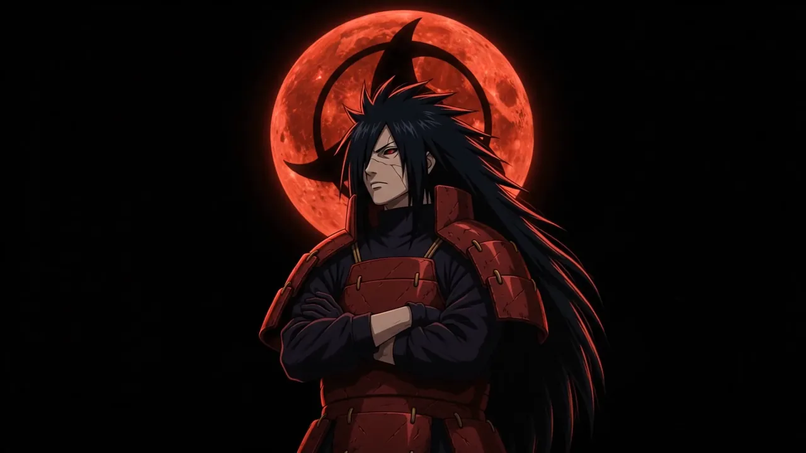

# Uchiha Madara — 終わりなき夢

An immersive, scroll-driven tribute to Uchiha Madara (Naruto) — three ascensions under a bleeding moon.

## Preview



## Features

- **Hero — Cursor-Tracked Turn**: 70 original frames follow your cursor; Madara's gaze tracks pointer position with a critically-damped spring
- **Awakening — Scroll-Scrubbed Sequence**: 38 frames pinned and scrubbed by scroll, revealing the seal breaking, chakra surging, and eyes opening
- **Three Forms — Jagged Tear Transitions**: Signature Naruto-style crack-wipe between Edo Tensei, Ten-Tails Jinchūriki, and Rinne Sharingan — lightning rides the tear line with flash and screen shake
- **Ambient Layers**: Falling glyph rain (kanji/kana), full-screen procedural thunder every 2s, film grain, scanlines
- **Custom Cursor**: Sharingan iris with magnetic pull on CTAs, click sparks, and card tilt
- **Motion Stack**: GSAP 3.12 + ScrollTrigger + Lenis (single smooth-scroll engine)
- **Performance**: Canvas 2D, single rAF, DPR-capped, paused when hidden, IntersectionObserver gating
- **Accessibility**: `prefers-reduced-motion` support (static fallback), semantic HTML, focus-visible, ARIA labels

## Tech Stack

| Layer | Technology |
|-------|------------|
| Animation | GSAP 3.12, ScrollTrigger |
| Smooth Scroll | Lenis 1.1 |
| Fonts | Google Fonts: Dela Gothic One, M PLUS 1 Code, Shippori Mincho B1, Zen Kaku Gothic New |
| Assets | 108 WebP frames (70 turn + 38 awaken + 12 form stages + event art) |
| Build | None — pure static ES modules |

## Quick Start

```bash
# Option 1: Direct open (works for most features)
open index.html

# Option 2: Local server (recommended for ES modules + external CDN)
npx serve .
# or
python -m http.server 8000
# then visit http://localhost:8000
```

## Project Structure

```
Madara/
├── index.html          # Single-page markup
├── app.js              # All logic (1084 lines, IIFE, ES modules via CDN)
├── styles.css          # Complete styling (560 lines, CSS custom properties)
├── package.json        # Metadata only
└── assets/
    ├── frames/
    │   ├── turn/       # 70 frames: hero cursor-tracked sequence
    │   └── awaken/     # 38 frames: scroll-scrubbed awakening (missing - uses turn as placeholder)
    ├── forms/          # 12 stages (3 forms × 3 stages + 3 ambient)
    ├── event/          # 10 event illustrations
    └── spotify-stats.json
```

## Key Sequences

| Sequence | Frames | Trigger | Location |
|----------|--------|---------|----------|
| `turn` | 70 | Cursor X position (hero) | `assets/frames/turn/turn_001–070.webp` |
| `awaken` | 38 | Scroll progress (pinned) | `assets/frames/awaken/awaken_001–038.webp` |

> **Note**: The `awaken` frames are not yet present in the repo — the sequence currently falls back to the nearest loaded frame. Add 38 frames named `awaken_001.webp` through `awaken_038.webp` to `assets/frames/awaken/` to complete it.

## Three Forms Data

Each form has 3 stages (forming → surging → manifest) and spec metadata:

| Form | Japanese | Accent | Key Ability |
|------|----------|--------|-------------|
| Edo Tensei | 穢土転生 | `#e0202a` (crimson) | Perfect Susanoo, Immortal reanimation |
| Ten-Tails Jinchūriki | 十尾人柱力 | `#9fb4d8` (bone) | Truth-Seeking Orbs, Rinnegan both eyes |
| Rinne Sharingan | 輪廻写輪眼 | `#8b5cf6` (violet) | Infinite Tsukuyomi, Third eye |

## Customization

### Accent Colors (CSS custom properties)
```css
:root {
  --crimson: #e0202a;   /* Edo Tensei */
  --bone:    #d8d4cc;   /* Ten-Tails */
  --rinne:   #8b5cf6;   /* Rinne Sharingan */
}
```
JS rewrites `--accent` per section via `applyAccent(hex)`.

### Thunder Colors
```js
const ACCENT_BOLT = {
  '#e0202a': 'crimson',
  '#5aa8ff': 'volt',
  '#9fb4d8': 'white',
  '#8b5cf6': 'rinne'
};
```

## Reduced Motion

When `prefers-reduced-motion: reduce` is set:
- All animations/transitions disabled
- Glyph rain, thunder, grain, scanlines, cursor hidden
- Pinned sections become static stacks showing final frames
- Preloader dismisses instantly

## Browser Support

- Modern browsers with ES modules, Canvas 2D, IntersectionObserver
- GSAP/Lenis loaded via jsDelivr CDN (requires internet)
- No build step, no Node runtime required

## Credits

- **Character**: Uchiha Madara — Masashi Kishimoto / Naruto
- **Fonts**: Google Fonts (Dela Gothic One, M PLUS 1 Code, Shippori Mincho B1, Zen Kaku Gothic New)
- **Animation**: GSAP by GreenSock, Lenis by Studio Freight
- **Assets**: Original frame sequences & illustrations (see `assets/`)

## License

Private project — not licensed for redistribution.